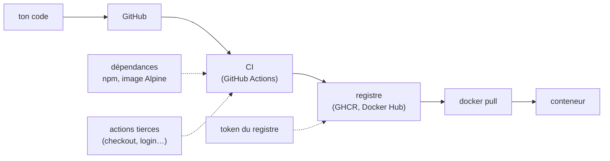
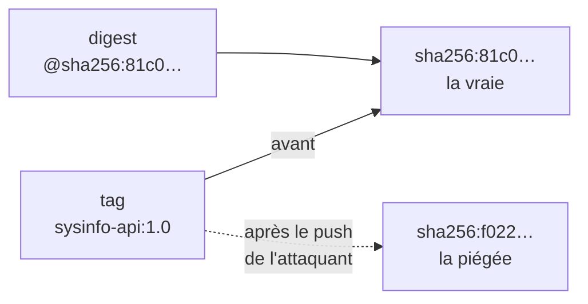
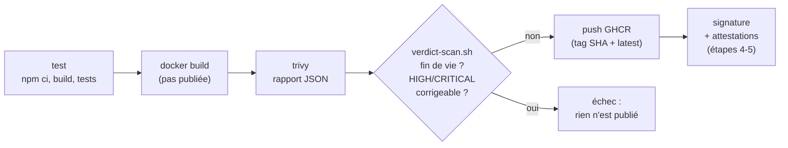
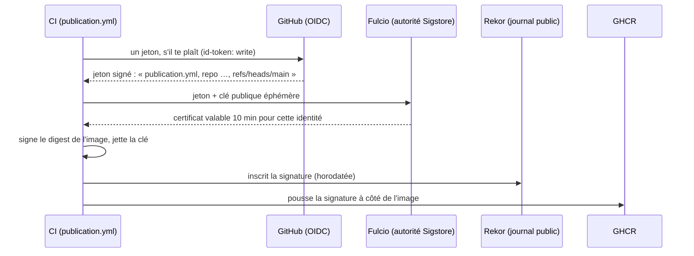

# Fiche — Piste 4 : la chaîne de confiance (supply chain)

> **La question** : quand on lance `docker pull crazzybuilds/sysinfo-api`,
> comment être sûr de ce qu'on lance ?
> **La méthode** : attaquer d'abord (détourner un tag), puis ajouter une à une
> les protections — scan, SBOM, signature, provenance — sur l'API du TP, et
> rejouer l'attaque.

---

## 1. Le problème : tout ce qui se trouve entre ton code et le conteneur



Chaque flèche est un endroit où quelqu'un peut glisser autre chose. Les vraies
attaques visent ces maillons plutôt que le code :

| Attaque | Maillon visé |
|---|---|
| **SolarWinds** (2020) | le système de build : le logiciel officiel, signé, contenait une porte dérobée |
| **Codecov** (2021) | un script utilisé par des milliers de CI, modifié pour voler leurs secrets |
| **xz-utils** (2024) | une bibliothèque de base de Linux, piégée par un mainteneur infiltré pendant 2 ans |
| **tj-actions/changed-files** (2025) | une action GitHub : ses tags (`v35`…) redirigés vers un commit qui affichait les secrets des CI |

**Trois questions, trois outils :**

| Question | Réponse | Outil |
|---|---|---|
| Est-ce bien ma CI qui a construit cette image ? | la **signature** (et la **provenance**) | cosign, Sigstore |
| Qu'y a-t-il dedans ? | le **SBOM** (la liste des ingrédients) | syft |
| Y a-t-il des failles connues dedans ? | le **scan** | trivy |

---

## 2. Étape 1 : un tag n'est qu'une étiquette

`attaque/demo-tag.sh`, sur un registre local qui joue Docker Hub :

```text
== 1. La CI publie la vraie image
   sysinfo-api:1.0 -> sha256:81c0e245…
== 2. L'attaquant pousse une image piégée sous le MÊME tag
   sysinfo-api:1.0 -> sha256:f02273f7…
== 3. La victime fait un pull du tag, comme d'habitude
   reçu : sha256:f02273f7…
   [piège] variables qui partiraient chez l'attaquant : AWS_SECRET_ACCESS_KEY DB_PASSWORD …
   Server listening on http://localhost:8000          ← et l'API marche, rien ne se voit
== 4. Avec le digest, on obtient exactement ce qu'on a demandé
   sysinfo-api@sha256:81c0e245… : CMD = ["node","dist/index.js"]
```



> [!tip] À retenir
> Un **tag** (`:1.0`, `:latest`, `@v4` pour une action) est un **pointeur
> mobile**. Un **digest** (`@sha256:…`) est l'empreinte du **contenu** : si un
> seul octet change, le digest change. On vérifie et on lance **par digest**.

---

## 3. Étape 2 : SBOM et scan, et le piège de la fin de vie

**Le SBOM** de l'image du TP (syft) : **28 composants**, 25 paquets Alpine
(`nodejs 20.15.1`, `musl`, `busybox`, `libcrypto3`…) et 2 paquets npm (l'API et
`systeminformation`, qui n'a aucune dépendance). Les 534 paquets npm du
`package-lock.json` sont presque tous des outils de développement (jest,
eslint, typescript…) : grâce au build en deux étapes du TD2, ils ne sont pas
dans l'image.

**Le scan** (trivy) : seulement **2 failles HIGH**, dans `musl`. Trop beau :

```text
"OS": {"Family": "alpine", "Name": "3.20.10", "EOSL": true}
```

**Alpine 3.20 est en fin de vie** (*end of service life*), Node 20 aussi. Plus
personne ne publie de bulletin de sécurité pour elles, donc le scanner n'a plus
rien à comparer. Pourtant, nodejs.org liste **5 versions de sécurité de Node 20
sorties après la 20.15.1** (de janvier 2025 à mars 2026), qui ne sont pas dans
l'image.

> [!warning] À retenir
> Un scanner ne trouve que les failles qu'on lui a signalées. « 0 faille » sur
> une distribution en fin de vie ne veut **rien** dire. D'où la règle du
> verdict : **refuser une distribution en fin de vie**, quel que soit le
> nombre de failles.

**La correction** : `FROM alpine:3.23@sha256:469c9ea4…` (Node 24, maintenu),
épinglée par digest (leçon de l'étape 1, appliquée à notre propre image de
base).

| | Alpine 3.20 (TP) | Alpine 3.23 |
|---|---|---|
| Node | 20.15.1 (fin de vie) | 24.22.3 |
| Fin de vie | **oui** | non |
| Failles HIGH | 2 (corrigeables) | 0 |
| Verdict | **REFUSÉ** | ACCEPTÉ |

Autre détail parlant : le même scan a trouvé **1 faille MEDIUM** en local et
**7** dans la CI. La base de failles locale avait 5 jours, celle de la CI était
à jour : **un scan vaut ce que vaut sa base**, et il faut le refaire
régulièrement, pas seulement au build.

---

## 4. Étape 3 : la CI scanne avant de publier



Les choix de sécurité du workflow (`.github/workflows/publication.yml`) :

| Choix | Pourquoi |
|---|---|
| `permissions: {}` puis droits par job | le jeton de la CI n'a que ce qu'il faut : `packages: write` pour publier, `id-token: write` pour signer |
| actions épinglées par **empreinte de commit** (`actions/checkout@3d3c42e…  # v7.0.1`) | un tag d'action se déplace, comme un tag d'image (tj-actions, 2025) |
| versions **d'au moins une semaine** (`cosign-installer` v4.1.3 plutôt que la v4.1.4 sortie la veille) | les versions piégées sont en général repérées et retirées en quelques jours |
| **Dependabot** avec `cooldown: 7 jours` | épingler sans mettre à jour = figer les failles ; Dependabot propose les nouveaux digests et empreintes |
| `persist-credentials: false` | le jeton Git n'est pas laissé sur le disque du runner |
| GHCR avec le `GITHUB_TOKEN` | aucun secret à créer ni à se faire voler |

---

## 5. Étape 4 : la signature keyless

**Keyless = pas de clé privée à garder.** La CI prouve *qui elle est* avec son
jeton OIDC (le même mécanisme qu'au TD4 pour Azure), et reçoit un certificat
valable 10 minutes.



Le certificat réellement émis (décodé avec `openssl x509`) :

```text
issuer    : O=sigstore.dev, CN=sigstore-intermediate
validité  : 21:18:47 → 21:28:47                    ← 10 minutes
identité  : https://github.com/CrazzyBuilds/chaine-de-confiance/.github/workflows/publication.yml@refs/heads/main
émetteur  : https://token.actions.githubusercontent.com
dépôt     : https://github.com/CrazzyBuilds/chaine-de-confiance
branche   : refs/heads/main
compte    : 204672074                               ← le même ID que dans le sujet OIDC du TD4
exécution : …/actions/runs/45703033801/attempts/1
journal   : entrée Rekor n° 4 112 004 349
```

Le certificat expire 10 minutes après : c'est l'**inscription horodatée dans
Rekor** qui prouve que la signature a été faite pendant sa validité.

**La vérification** (`scripts/verifier.sh`) : traduit le tag en digest, exige
une signature de **cette identité** précise, puis lance l'image **par digest**.

**L'attaque rejouée** (`attaque/demo-signature.sh`) :

| Cas | Résultat | Pourquoi |
|---|---|---|
| la vraie image, copiée avec sa signature | ✅ signature valide | certificat Fulcio pour `publication.yml@refs/heads/main`, inscrit dans Rekor |
| image piégée sous le même tag | ❌ REFUSÉ : `no signatures found` | le digest a changé ; la signature porte sur l'ancien |
| image piégée **signée** avec la clé de l'attaquant | ❌ REFUSÉ : `0 < 1` entrée de journal | sa signature est valide… pour **sa** clé ; pas de certificat pour l'identité de la CI, pas d'inscription dans Rekor |

> [!tip] À retenir
> Signer ne suffit pas : ce qui protège, c'est **vérifier l'identité** du
> signataire. « Signé » ≠ « signé par ma CI, sur main ».

---

## 6. Étape 5 : SBOM et provenance, signés

La CI joint à l'image deux **attestations** : des déclarations signées avec
la même identité keyless.

```text
$ cosign tree ghcr.io/crazzybuilds/chaine-de-confiance@sha256:12c9dbbc…
├── https://spdx.dev/Document          ← le SBOM (syft, attesté par cosign)
├── https://slsa.dev/provenance/v1     ← la provenance (actions/attest-build-provenance)
└── https://sigstore.dev/cosign/sign   ← la signature de l'étape 4
```

`scripts/inspecter.sh` les **vérifie** puis les lit :

```text
== Provenance (vérifiée par gh attestation verify)
  dépôt    : https://github.com/CrazzyBuilds/chaine-de-confiance
  workflow : .github/workflows/publication.yml
  branche  : refs/heads/main
  commit   : 1049bb633cab79ff37ea0fbaad3be347853d2a89
  exécution: …/actions/runs/45703931349/attempts/1

== SBOM (vérifié par cosign verify-attestation)
  nodejs 24.22.3-r0
  musl 1.2.5-r24
  …
```

- **La provenance** remonte de l'image au **commit exact** : on peut relire le
  code qui a produit ce qu'on exécute.
- **Le SBOM signé** répond à « suis-je touché ? » le jour où sort la prochaine
  faille du genre xz, **sans avoir à télécharger ni ouvrir l'image**.
- BuildKit joignait déjà une provenance minimale à l'image, mais **non
  signée** : n'importe qui qui pousse une image peut en écrire une.

---

## 7. Ce que tout ça ne protège pas

| Menace | Pourquoi ça passe | Ce qui aiderait |
|---|---|---|
| quelqu'un pousse du code piégé **sur main** | la CI construit et signe : signature valide | protection de branche, relecture obligatoire, signature des commits |
| une **dépendance** piégée en amont (xz) | elle est dans l'image signée, avec notre signature | le SBOM permet de **réagir** vite, pas de prévenir |
| personne ne vérifie | une signature non vérifiée ne protège rien | vérifier **au déploiement** : un contrôleur d'admission Kubernetes (Kyverno, policy-controller de Sigstore) refuse les images non signées → piste 3 |
| une faille publiée **après** le build | le scan était bon au moment du build | rescanner régulièrement les images publiées |

Et un effet de bord : le journal Rekor est **public**. Il contient l'identité
du signataire (nom du repo, du workflow) : à savoir pour un repo privé.

---

## 8. Les pièges rencontrés

| Symptôme | Cause | Leçon |
|---|---|---|
| trivy : `permission denied` sur `~/.cache/trivy/db` | le cache avait été créé par un `sudo trivy` | un outil lancé une fois en root laisse des fichiers root dans ton home |
| « seulement 2 failles » dans Node 20.15.1 | distribution en **fin de vie** : plus aucune faille signalée | lire `EOSL`, pas seulement le compte de failles |
| 1 faille MEDIUM en local, 7 dans la CI | base de failles locale vieille de 5 jours | un scan vaut ce que vaut sa base |
| GHCR : `denied` au tout premier push | le paquet est créé pendant le push, les droits du jeton arrivent juste après | relancer le job (`gh run rerun --failed`) |
| `cosign copy` ne recopie pas la signature | le nouveau format (*bundle*, cosign 3) est rangé sous un tag `sha256-<digest>` que la copie traite mal | copier avec `crane` l'image puis ce tag |
| `--tlog-upload=false` refusé | cosign 3 passe par une « signing config » | `--use-signing-config=false` |
| GHCR : 404 sur l'API `referrers` | GHCR ne la gère pas | cosign se rabat sur le tag `sha256-<digest>` |

---

## 9. Reproduire

```sh
attaque/demo-tag.sh                        # étape 1 : détourner un tag
docker build -t cdc:local .
syft cdc:local -o table                    # étape 2 : SBOM
trivy image -f json -o t.json cdc:local && scripts/verdict-scan.sh t.json
# étapes 3 à 5 : à chaque push sur main (.github/workflows/publication.yml)
scripts/verifier.sh ghcr.io/crazzybuilds/chaine-de-confiance:latest -p 8000:8000
scripts/inspecter.sh ghcr.io/crazzybuilds/chaine-de-confiance:latest
attaque/demo-signature.sh                  # étape 4 : l'attaque face à la vérification
```

Outils : `cosign`, `syft`, `trivy`, `crane` (paquets Arch), `gh`, Docker.

---

## 10. Questions pour vérifier

<details><summary>1. Pourquoi un tag ne suffit-il pas à désigner une image ?</summary>
Un tag est un pointeur que n'importe qui ayant le droit d'écrire sur le registre peut déplacer vers un autre contenu. Le digest est l'empreinte du contenu lui-même : il ne peut désigner qu'une seule image.
</details>

<details><summary>2. Le scan ne trouve que 2 failles dans l'image du TP : est-elle sûre ?</summary>
Non : Alpine 3.20 et Node 20 sont en fin de vie, donc plus aucune faille n'est signalée pour elles. Node a pourtant publié 5 versions de sécurité depuis la 20.15.1. Un scanner ne connaît que les failles qu'on lui a déclarées.
</details>

<details><summary>3. Pourquoi épingler les actions GitHub par empreinte de commit ?</summary>
Pour la même raison que les images : un tag d'action (v4) peut être redirigé vers un autre code, comme pour tj-actions/changed-files en 2025. L'empreinte d'un commit désigne un code précis.
</details>

<details><summary>4. Si on épingle tout par digest, comment reçoit-on les correctifs ?</summary>
Avec Dependabot (ou Renovate), qui propose une pull request quand une nouvelle version sort. Le délai d'attente (cooldown) évite d'adopter une version piégée le jour de sa sortie.
</details>

<details><summary>5. Qu'est-ce que « keyless » veut dire, s'il y a quand même une signature ?</summary>
Il n'y a pas de clé privée à long terme. La CI prouve son identité avec son jeton OIDC, reçoit un certificat valable 10 minutes pour une clé éphémère, signe, puis jette la clé. Rien à garder, rien à se faire voler.
</details>

<details><summary>6. Le certificat expire après 10 minutes : comment vérifier la signature demain ?</summary>
La signature est inscrite et horodatée dans Rekor, le journal public de Sigstore. Il prouve qu'elle a été faite pendant la validité du certificat.
</details>

<details><summary>7. L'attaquant signe son image avec sa propre clé : pourquoi est-elle refusée ?</summary>
La vérification n'exige pas « une signature », mais une signature par l'identité de notre CI (publication.yml, sur main, émise par GitHub). Sa signature est valide pour sa clé, pas pour cette identité, et elle n'est pas dans le journal public.
</details>

<details><summary>8. Quelle différence entre la signature, le SBOM et la provenance ?</summary>
La signature dit « ce digest a été publié par ma CI ». Le SBOM dit « voici ce qu'il contient ». La provenance dit « il a été construit à partir de tel commit, par tel workflow ». Les deux derniers sont des attestations, signées avec la même identité.
</details>

<details><summary>9. Une image signée par notre CI peut-elle quand même être dangereuse ?</summary>
Oui : si du code piégé arrive sur main, ou si une dépendance est piégée en amont (xz), la CI le construit et le signe. La signature garantit l'origine, pas l'innocence du contenu.
</details>

<details><summary>10. Où faudrait-il vérifier les signatures en production ?</summary>
Au moment du déploiement, de façon automatique : par exemple un contrôleur d'admission Kubernetes (Kyverno, policy-controller) qui refuse de lancer une image sans signature valide de la bonne identité.
</details>
